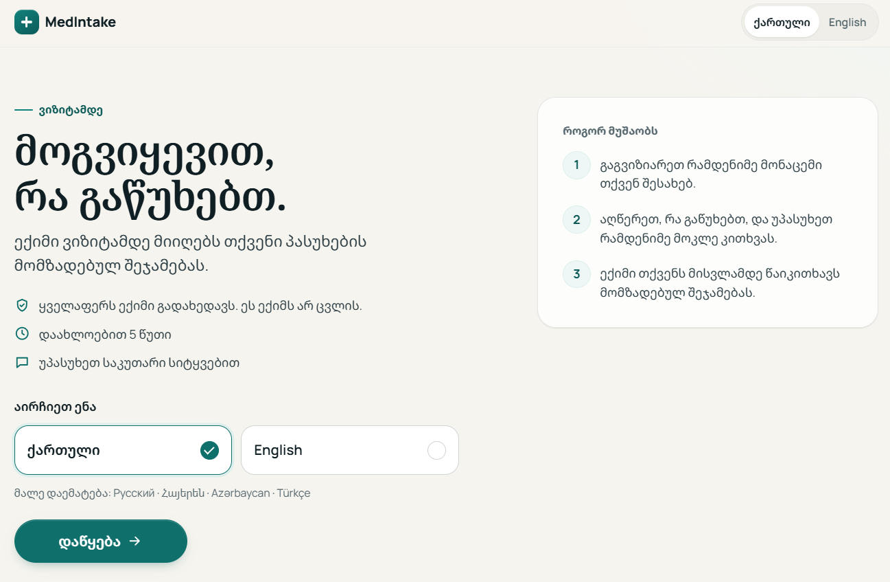
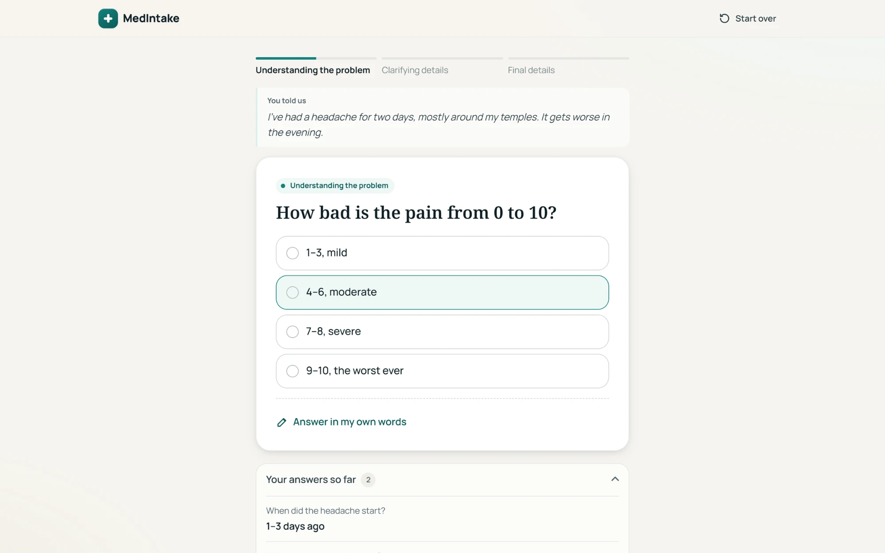
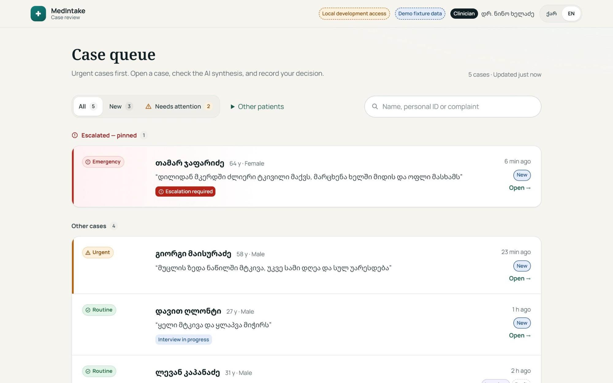
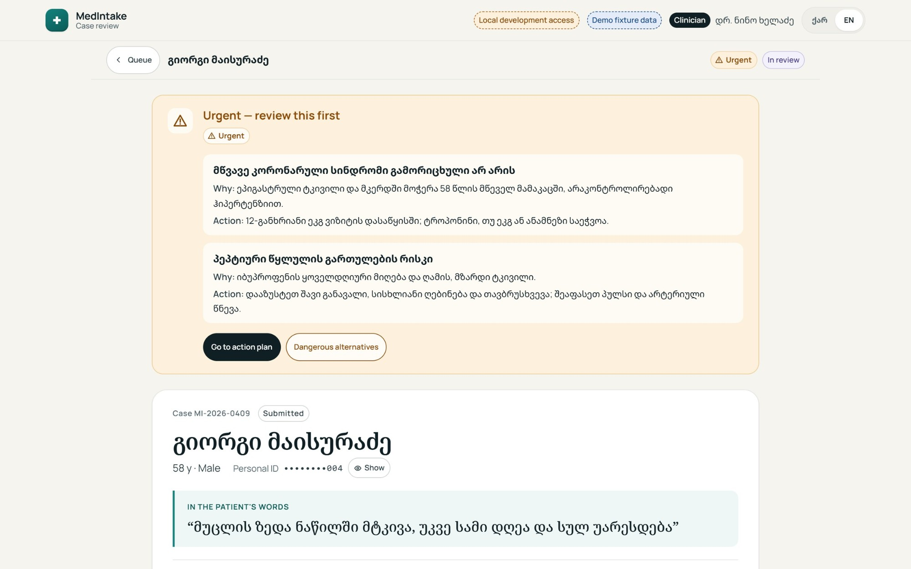
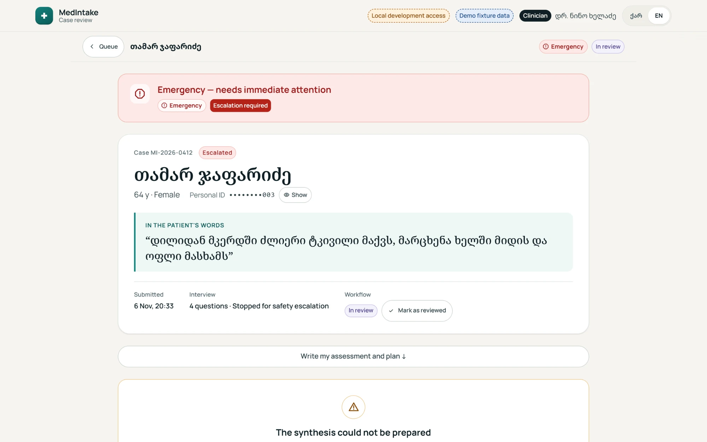

# MedIntake

A pre-visit intake form for clinics in Georgia. The patient fills it in before the appointment, answers a few follow-up questions about what's bothering them, and the doctor gets a short case summary to read before the patient walks in.

It's in Georgian and English, and it's plain HTML, CSS and JavaScript — no framework, no build step.



## How it works

The patient side is a four-step form: name and personal ID, contact and insurance, an optional medical history step, and then the complaint in their own words. After that comes a short interview — one question at a time, tap an answer or type your own. If something sounds urgent, the patient gets a banner with a button to call 112.



On the clinic side, doctors get a queue sorted by urgency. Emergencies are pinned to the top. Opening a case shows the patient's own words, the safety flags, an AI-prepared summary, the full interview and the patient's details. The doctor then writes their own assessment and plan. AI output and the doctor's notes look different on purpose, so it's always clear who said what.



| Urgent case | Emergency case |
| --- | --- |
|  |  |

## Running it

You need Node 18 or newer. There's nothing to install.

```bash
npm start
```

Then open:

- http://localhost:8080 for the patient side
- http://localhost:8080/doctor/?fixture=1 for the clinic side

The real interview runs on an AI model behind a backend that isn't in this repo. For local use, `demo/server.js` stands in for it with a short scripted interview about a headache, so you can click through the whole flow without an API key. The clinic side runs on sample cases from `doctor/dev-fixtures.js`. Add `&auth=0` to the URL to see the sign-in page (the key is `demo`).

## Project layout

```
index.html, app.js, i18n.js, patient.css   patient side
doctor/                                     clinic side (queue, case view, sign-in)
tokens.css                                  colours, fonts, spacing shared by both
demo/server.js                              local server with a fake API
```

## Backend

This repo is only the front end. In production it talks to a separate server that runs the interview, stores cases and handles clinic sign-in. If you want to write your own, the endpoints the pages expect are all in `demo/server.js` (patient side) and `doctor/dev-fixtures.js` (`/api/session`, `/api/login`, `/api/review/*`).

## A note on medical use

This isn't a certified medical device and it doesn't give medical advice. The AI summary can be wrong, and a doctor has to review every case. If you put it in front of real patients, you're responsible for data protection and any medical device rules that apply where you are.

All names, ID numbers, phone numbers and emails in this repo are made up.

## License

[PolyForm Noncommercial 1.0.0](LICENSE). You're welcome to read the code, run it, change it and use it for anything non-commercial: personal projects, research, teaching, charities and public institutions.

Commercial use is not allowed without a separate license from me. That includes private clinics, paid or hosted services, reselling, and building it into something you sell. [COMMERCIAL.md](COMMERCIAL.md) spells out what counts and how to ask.

"MedIntake" and the logo aren't covered by the license. If you fork the project, please give it a different name.
